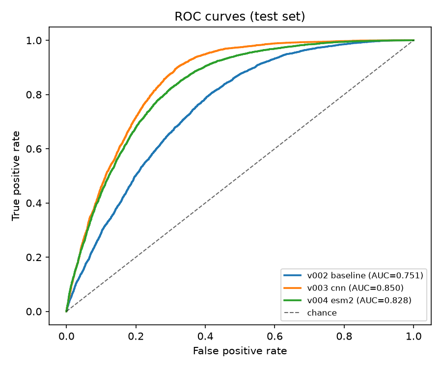
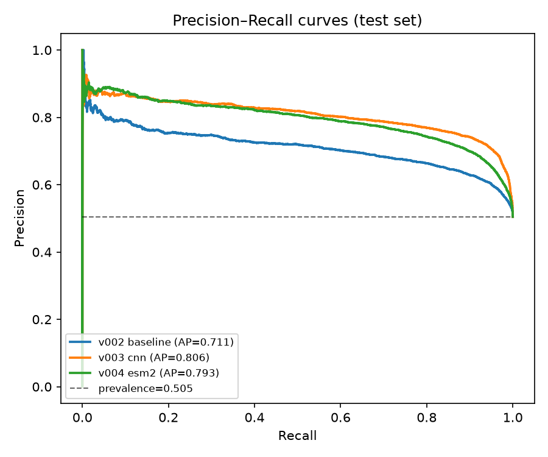
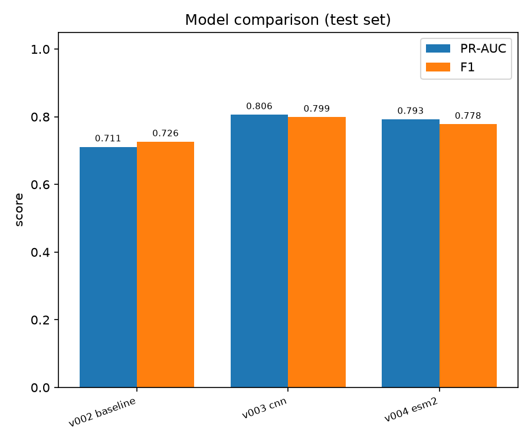

# Benchmark

Evaluated on the same held-out test split (`data/processed/test.csv`, n=14761, positive rate=50.5%). Ranked by PR-AUC (descending). Primary metric: **pr_auc**.

| version | model_type | param_count | accuracy | precision | recall | f1 | roc_auc | pr_auc |
|---|---|---:|---:|---:|---:|---:|---:|---:|
| v003_cnn_20261012_215106 ★ | cnn | 25,505 | 0.7854 | 0.7578 | 0.8453 | 0.7991 | 0.8503 | 0.8064 |
| v004_esm2_20261012_220945 | esm2 | 41,217 | 0.7611 | 0.7327 | 0.8296 | 0.7781 | 0.8284 | 0.7927 |
| v002_baseline_20261012_214724 | baseline | 11,966 | 0.6947 | 0.6633 | 0.8028 | 0.7264 | 0.7514 | 0.7112 |

★ = current champion (highest PR-AUC, per `models/LATEST.json`).

## Figures

> **Note.** `param_count` is the number of trainable parameters for the neural models (cnn, esm2) and the total number of leaves across all trees for the LightGBM baseline.

> **Footnote — context, not a head-to-head comparison.** The DeepMSPeptide paper (Serrano et al., *Bioinformatics* 2020) reported roughly **93% sensitivity / 99% specificity** on **their own** test set. This benchmark uses a *different* train/val/test split of the GPMDB-derived data, so those figures are **context only** and are **not** directly comparable to the numbers above.
